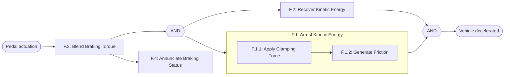
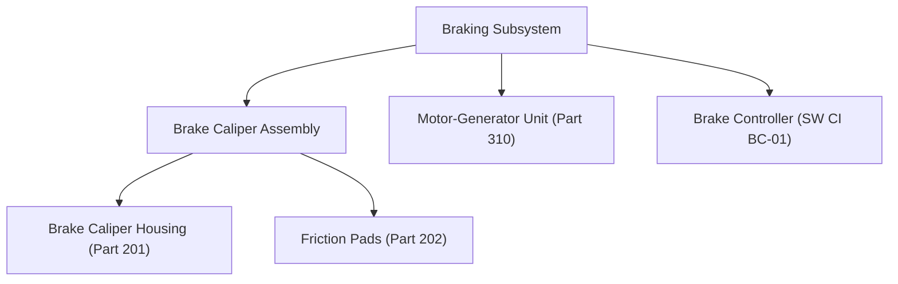
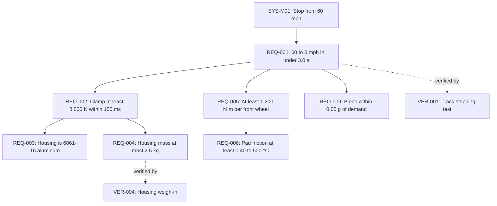

# Systems Engineering Skill for Claude Code

[](LICENSE)
[](#commands)
[](#commands)
[](https://www.nasa.gov/reference/systems-engineering-handbook/)
[](https://github.com/sweetscientist/systems-engineering-skill/stargazers)

**Works with:** Claude Code (plugin, all 34 slash commands) · OpenAI Codex[^skills] · Gemini CLI[^skills] · OpenCode[^skills] · Windsurf[^skills] · Antigravity[^skills] · Hermes Agent[^skills] · Mistral Vibe[^skills]

[^skills]: Untested. These tools load skills in the [Agent Skills](https://agentskills.io) `SKILL.md` format, so `skills/systems-engineering/` should load as a skill, but the `/systems-engineering:<group>:<method>` slash commands are Claude Code only. Ask in plain language instead ("run design:requirements for …"). Where the skill calls for Claude Code's `AskUserQuestion` tool, other agents ask in chat. Install steps are under [Other agents](#other-agents).

A [Claude Code](https://claude.com/claude-code) plugin that does structured systems-engineering work, organized around the [NASA Systems Engineering Handbook](https://www.nasa.gov/reference/systems-engineering-handbook/) (NASA/SP-2016-6105 Rev 2). It covers stakeholder expectations through transition, the crosscutting technical management processes, life-cycle reviews, and specialty analyses, all on one shared, traceable set of artifacts.

Every artifact is linked by ID, so a change in one place can be traced through the others. Methods that create artifacts work like plan mode: they read your inputs, ask only the questions that change the result, propose a structure, and write nothing until you approve it.

## Commands

Commands are namespaced `/systems-engineering:<group>:<method>`. Type `/systems-engineering:` to see them all.

### `design:` System design processes (SEH §4)

| Command | What it does |
|---|---|
| `design:stakeholders` | Stakeholder register, needs / goals / objectives, MOEs, mission success criteria |
| `design:conops` | Concept of operations per SEH App S: environments, nominal and off-nominal scenarios |
| `design:requirements` | Build or audit a Standard Requirements Matrix (seven columns, strict traceability, ADIT), MOPs and TPMs, SEH six-step validation, App C checklists |
| `design:decomposition` | Function tree (FFBD), timing and modes, allocation, derived requirements |
| `design:solution` | Physical breakdown (PBS), alternatives, enabling products, end-product specs |

### `realization:` Product realization processes (SEH §5)

| Command | What it does |
|---|---|
| `realization:implementation` | Buy / make / reuse per element, heritage and requalification |
| `realization:integration` | Integration sequence and plan per SEH App H |
| `realization:verification` | Verification matrix (VCRM): qualification, acceptance, protoflight; verification reports |
| `realization:validation` | Validation matrix traced to ConOps, NGOs, and MOEs per SEH App E |
| `realization:transition` | Handover readiness: documentation, training, shipping, installation, sustaining |

### `management:` Crosscutting technical management (SEH §6)

| Command | What it does |
|---|---|
| `management:planning` | SEMP per SEH App J, WBS, technical schedule keyed to reviews |
| `management:requirements` | Read-only traceability: `impact <ID>`, `coverage`, `change <CR-###>` |
| `management:interfaces` | N² matrix, interface list, IRD / ICD per SEH App L |
| `management:risk` | Risk register: risk triplet, RIDM vs. CRM, triggers, mitigation and contingency |
| `management:config` | Baselines (functional, allocated, product, as-deployed), change requests, waivers, status accounting |
| `management:data` | Technical data items: owner, format, access, storage |
| `management:assessment` | TPM tracking against planned profile and tolerance bands, MOE / MOP rollup |
| `management:decision` | Trade studies: weighted matrix, AHP, decision tree, Borda, utility; decision report |

### `lifecycle:` Program / project life cycle (SEH §3)

| Command | What it does |
|---|---|
| `lifecycle:reviews` | Readiness for MCR through DRR: entrance and success criteria checked against the workspace, findings and RFAs |
| `lifecycle:phases` | Read-only: current phase, products due, next review |
| `lifecycle:tailoring` | Tailoring / compliance matrix with justifications (SEH §3.11) |
| `lifecycle:readiness` | Technology readiness (TRL) with evidence and maturation plans (SEH App G) |

### `specialty:` Specialty analyses

These are techniques the handbook names or depends on but doesn't define, so each method cites its own source standard.

| Command | What it does |
|---|---|
| `specialty:fmea` | Design FMEA (S × O × D → RPN, or Action Priority) |
| `specialty:fta` | Fault tree analysis, minimal cut sets |
| `specialty:stpa` | STPA hazard analysis: losses, hazards, control structure, UCAs, loss scenarios |
| `specialty:ram` | Reliability block diagrams, MTBF / MTTR, availability |
| `specialty:safety-case` | Assurance case in GSN, linked to verification evidence |
| `specialty:hsi` | Human systems integration per SEH App R |
| `specialty:budgets` | Mass, power, data, and other resource budgets with margin |
| `specialty:lcc` | Life-cycle cost breakdown and estimating approach |
| `specialty:dsm` | Design structure matrix: clustering and partitioning |
| `specialty:morph` | Morphological (Zwicky) analysis to generate candidate concepts |

### `model:` Modeling

| Command | What it does |
|---|---|
| `model:diagrams` | Mermaid views (context, FFBD, physical, interface, trace, STPA, fault tree, timeline), every node keyed to an artifact ID |
| `model:sysml` | SysML v2 textual export of the workspace |

## Install

**As a plugin (recommended):**

```
/plugin marketplace add sweetscientist/systems-engineering-skill
/plugin install systems-engineering@systems-engineering-skill
```

**Without the plugin system:**

```bash
git clone https://github.com/sweetscientist/systems-engineering-skill.git
cp -R systems-engineering-skill/skills/systems-engineering ~/.claude/skills/
mkdir -p ~/.claude/commands/systems-engineering
cp -R systems-engineering-skill/commands/ ~/.claude/commands/systems-engineering/
```

Both give the same `/systems-engineering:<group>:<method>` commands. Restart Claude Code after installing. You can also just describe the task ("build a requirements matrix for…") and Claude will pick up the skill.

### Other agents

Copy the skill folder into the agent's skills directory. The commands folder is Claude Code only and isn't needed.

```bash
git clone https://github.com/sweetscientist/systems-engineering-skill.git
cp -R systems-engineering-skill/skills/systems-engineering <skills-dir>/
```

| Agent | Skills directory (check your tool's docs) |
|---|---|
| OpenAI Codex | `~/.codex/skills/` |
| OpenCode | `.opencode/skills/` |
| Windsurf | `.windsurf/skills/` |
| Antigravity | `~/.gemini/antigravity/skills/` |
| Hermes Agent | `~/.hermes/skills/` |
| Mistral Vibe | `~/.vibe/skills/` |
| Gemini CLI | See the Gemini CLI skills documentation |

## Usage

The two features most people use are **building a requirements matrix** and **drawing diagrams from it**. Both work from a short brief, existing documents, or a plain-language request. Commands that create files show a proposal first and write nothing until you approve it.

### Build a requirements matrix

Point the command at a system name or at your source documents:

```text
/systems-engineering:design:requirements "Regenerative braking system"
/systems-engineering:design:requirements docs/brake-brief.md docs/brake-bom.xlsx
```

Or just ask: *"Build a requirements matrix for our braking system from docs/brake-brief.md."*

**Step 1: Read.** The skill reads your inputs and any existing `<system>-se/` workspace.

**Step 2: Ask.** It asks only the questions that change the result: system boundary, depth (subsystem or part), and ID scheme. If your documents already use `REQ-###`, it keeps that scheme.

**Step 3: Propose, then stop.** Nothing is written until you approve.

```text
## Requirements matrix proposal: Regenerative braking system

System boundary: pedal input to wheel torque and stored energy; driver, battery pack,
                 and instrument cluster are external
ID scheme: REQ-### (adopted from brake-brief.md)
Parents (SYS-level): SYS-M01 stop from 60 mph in under 3.0 s
                     SYS-M02 recover braking energy to the battery
                     SYS-M03 inform the driver when regenerative braking is unavailable
Functional blocks / elements: F.1–F.4 from brake-brief.md; elements from brake-bom.xlsx
Key driving requirements: REQ-001 stopping time, REQ-009 torque blending
Verification constraints: brake dynamometer and vehicle test track available
Expected size: 10 rows (6 functional, 4 physical)
Known gaps going in: none
Output: regenerative-braking-system-se/requirements.csv, rationale.csv, measures.csv
```

**Step 4: Build and validate.** After you approve, it writes `requirements.csv` and checks every row:

| Req ID | Parent ID | Requirement Text | Requirement Type | Functional Block (What) | Allocated Element (Where/How) | Verification Method |
|---|---|---|---|---|---|---|
| REQ-001 | SYS-M01 | The system shall decelerate the vehicle from 60 mph to 0 mph in less than 3.0 seconds on dry pavement. | Functional | F.1: Arrest Kinetic Energy | Braking Subsystem | Test |
| REQ-002 | REQ-001 | The brake caliper assembly shall clamp the rotor with a force of at least 8,000 N within 150 ms of pedal actuation. | Functional | F.1.1: Apply Clamping Force | Brake Caliper Assembly | Test |
| REQ-003 | REQ-002 | The caliper housing shall be constructed from 6061-T6 aluminum alloy. | Physical | F.1.1: Apply Clamping Force | Brake Caliper Housing (Part 201) | Inspection |
| REQ-004 | REQ-002 | The caliper housing shall have a mass of no more than 2.5 kg. | Physical | F.1.1: Apply Clamping Force | Brake Caliper Housing (Part 201) | Test |
| REQ-005 | REQ-001 | The friction pads shall generate a braking torque of at least 1,200 N·m per front wheel at 8,000 N clamp force. | Functional | F.1.2: Generate Friction | Friction Pads (Part 202) | Test |
| REQ-006 | REQ-005 | The friction pads shall maintain a coefficient of friction of at least 0.40 at operating temperatures up to 500 °C. | Physical | F.1.2: Generate Friction | Friction Pads (Part 202) | Analysis |
| REQ-007 | SYS-M02 | The motor-generator unit shall convert at least 60 % of vehicle kinetic energy to battery charge during a 0.2 g deceleration from 30 mph to 0 mph. | Functional | F.2: Recover Kinetic Energy | Motor-Generator Unit (Part 310) | Test |
| REQ-008 | REQ-007 | The motor-generator unit shall deliver charging current to the battery pack interface at no more than 400 V DC. | Physical | F.2: Recover Kinetic Energy | Motor-Generator Unit (Part 310) | Test |
| REQ-009 | REQ-001 | The brake controller shall blend regenerative and friction braking so that total deceleration deviates from driver demand by no more than 0.05 g. | Functional | F.3: Blend Braking Torque | Brake Controller (SW CI BC-01) | Test |
| REQ-010 | SYS-M03 | The brake controller shall display a "Regen Braking Unavailable" message on the instrument cluster whenever regenerative braking is inhibited. | Functional | F.4: Annunciate Braking Status | Brake Controller (SW CI BC-01) | Demonstration |

Every row has a parent, one `shall`, a measurable target, a functional block, an allocated element, and exactly one verification method. Physical rows reuse their parent's block. If your inputs don't give a number, the cell shows `TBD` and the run ends with a **Gaps** list saying what input would close each one. The skill never invents values. The numbers above are illustrative.

#### Fully traced matrix

For more than a handful of functions, build the architecture first so every row gets a real block and element:

```text
/systems-engineering:design:requirements docs/brake-brief.md    # top-level rows from the brief
/systems-engineering:design:decomposition                        # F.X.X function tree (FFBD)
/systems-engineering:design:solution                             # physical element tree
/systems-engineering:design:requirements allocate                # fill blocks and elements, add child rows
```

#### Audit a matrix you already have

This is read-only. It changes nothing.

```text
/systems-engineering:design:requirements audit specs/brake-srm.xlsx
```

Example findings:

| Req ID | Check failed | Detail | Suggested fix |
|---|---|---|---|
| REQ-014 | Shall test | Two `shall`s in one row | Split into two rows; the new row continues the numbering |
| REQ-021 | Verifiable (App C) | "shall respond quickly" | State a response time with units, or `TBD` with an owner |
| REQ-030 | N-squared | One functional row allocated to both Brake Caliper Assembly and Motor-Generator Unit | Keep the functional row at Braking Subsystem; add one physical child per element |

`requirements.csv` is always written. Ask for XLSX or Markdown if you need either.

### Draw diagrams

Diagrams are rendered from the workspace as [Mermaid](https://mermaid.js.org). Every node is an artifact ID, so a diagram never shows structure that isn't in your data.

```text
/systems-engineering:model:diagrams all              # every diagram whose source exists
/systems-engineering:model:diagrams ffbd             # one view
/systems-engineering:model:diagrams trace REQ-001    # one requirement's full trace
```

| View | Shows | Needs first |
|---|---|---|
| `context` | System boundary, external actors, boundary interfaces | `design:solution`, `management:interfaces` |
| `ffbd` | Function flow with sequence and AND/OR junctions | `design:decomposition` |
| `physical` | Element tree (product breakdown structure) | `design:solution` |
| `interfaces` | Element-to-element interfaces labeled with IF IDs | `management:interfaces` |
| `trace <ID>` | Parents, children, verification, and risk links for one requirement | `design:requirements` |
| `ngo` | Stakeholders → needs → MOEs → system requirements | `design:stakeholders`, `design:requirements` |
| `stpa`, `fta <FT-###>`, `timeline` | Control structure, fault tree, review timeline | `specialty:stpa`, `specialty:fta`, `management:planning` |

If a view's source is missing, `all` skips it and names the command that produces it. Output goes to `<system>-se/diagrams.md`. GitHub renders Mermaid natively, so the file displays as diagrams in your repo. To edit one, paste the block into [mermaid.live](https://mermaid.live). To export SVG or PNG, use [mermaid-cli](https://github.com/mermaid-js/mermaid-cli).

These examples are drawn from the matrix above.

#### `ffbd`: functional flow block diagram



#### `physical`: element tree



#### `trace REQ-001`: requirement trace



### Other workflows

| Task | Command |
|---|---|
| Find what a requirement change touches | `/systems-engineering:management:requirements impact REQ-002` |
| Find traceability gaps across every artifact | `/systems-engineering:management:requirements coverage` |
| Build the verification matrix (VCRM) | `/systems-engineering:realization:verification` |
| Run a trade study | `/systems-engineering:management:decision "Select caliper housing material" aluminum titanium steel` |
| Run an FMEA on an assembly | `/systems-engineering:specialty:fmea "Brake Caliper Assembly"` |
| Check readiness for PDR | `/systems-engineering:lifecycle:reviews PDR` |
| Build stakeholders and a ConOps from a mission brief | `/systems-engineering:design:stakeholders brief.md`, then `/systems-engineering:design:conops` |

The full SEH flow is **stakeholders → conops → requirements → decomposition → solution → requirements `allocate` → interfaces → verification / validation → integration → transition**. Each run ends by listing what it wrote, open gaps, items for other commands, and the suggested next command.

## Shared workspace

All methods read and write one folder per system, `<system-slug>-se/`, so each builds on the others' output. Each ID prefix (`STK`, `NGO`, `MOE`, `SCN`, `SYS`, `FUNC`, `PHYS`, `MOP`, `TPM`, `ALT`, `IF`, `ICD`, `VER`, `VAL`, `RSK`, `BL`, `CR`, `TRD`, `REV`, `TECH`, `FM`, `FT`, `HAZ`, `UCA`, `GSN`, `BUD`, …) is owned by exactly one method. Other methods only reference it, and list anything missing as a *candidate* for the owning method. The full file list and ID table are in [`SKILL.md`](skills/systems-engineering/SKILL.md).

If your documents already use a different scheme (for example `REQ-###`), the skill adopts yours.

## The requirements matrix

The matrix has seven fixed columns:

`Req ID | Parent ID | Requirement Text | Requirement Type | Functional Block (What) | Allocated Element (Where/How) | Verification Method`

| Req ID | Parent ID | Requirement Text | Type | Functional Block | Allocated Element | Verification |
|---|---|---|---|---|---|---|
| REQ-001 | SYS-M01 | The system shall decelerate the vehicle from 60 mph to 0 mph in less than 3.0 seconds. | Functional | F.1: Arrest Kinetic Energy | Braking Subsystem | Test |
| REQ-002 | REQ-001 | The system shall clamp the rotor with a force of at least 8,000 Newtons within 150 milliseconds of pedal actuation. | Functional | F.1.1: Apply Clamping Force | Brake Caliper Assembly | Test |
| REQ-003 | REQ-002 | The caliper housing shall be constructed from 6061-T6 aluminum alloy. | Physical | F.1.1: Apply Clamping Force | Brake Caliper Housing (Part 201) | Inspection |

Three rules are enforced:

1. **The "shall" test.** A functional row says what the system *does*, and a physical row says what an element *is* or *has*. A single sentence never does both.
2. **Allocation enforcement.** Every functional row has a functional block, and every row handed to a design team has an allocated element. A blank cell is reported as an architecture gap.
3. **N-squared flow.** A function performed by several components is split into one child physical requirement per component.

The full framework is in [`skills/systems-engineering/reference/srm-framework.md`](skills/systems-engineering/reference/srm-framework.md).

## Design principles

- **Plan before writing.** Artifact-creating methods propose and wait for approval. A matrix built on the wrong system boundary is worthless.
- **Never invent numbers.** Missing targets, scores, ratings, probabilities, costs, dates, and part numbers become `TBD` or `Assumed: <basis>` and are listed under Gaps.
- **Never renumber.** Extending an artifact keeps every existing ID and continues the numbering.
- **Cite the source.** Each method names the SEH section (with page) or the external standard it follows. Criteria are paraphrased, and your organization's standards override them.
- **Diagrams are views, not sources.** Every Mermaid node maps to an artifact ID, and the skill won't draw structure it can't trace.
- **No project data in the skill.** Everything comes from your inputs and the workspace on each run.

## Layout

```
.claude-plugin/              # plugin and marketplace manifests
commands/<group>/<method>.md # thin entry points → /systems-engineering:<group>:<method>
skills/systems-engineering/
├── SKILL.md                 # router: methods, workspace, ID ownership, shared gate and rules
├── methods/<group>/<method>.md   # one file per method, loaded only when that method runs
└── reference/
    └── srm-framework.md     # Functional-Physical framework, three rules, ADIT guide
```

To add a method, create `methods/<group>/<method>.md` and `commands/<group>/<method>.md`, then add a row to the methods table in `SKILL.md`. If it creates new IDs, add a row to the ID table too.

## Limitations

- This is not a requirements-management tool. It produces CSV, Markdown, Mermaid, and SysML v2 text files you can import into Excel, Jama, DOORS, Cameo, or similar tools. It doesn't sync with them.
- The SysML v2 export hasn't been validated against a SysML v2 tool. Check it with your own toolchain.
- NASA terminology and review names are the default. DoD and other names are mapped where noted, and you can supply your own criteria.
- The output is a draft for engineering review. The skill enforces structure and traceability, but it can't tell whether a requirement is the right one.

## License

[MIT](LICENSE). Content from the NASA Systems Engineering Handbook is paraphrased and cited. The handbook is a U.S. Government work.
